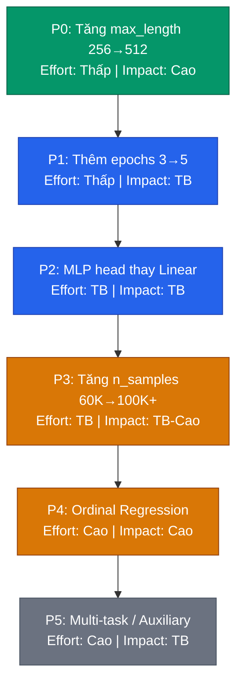

# 🔍 Insight từ Error Analysis → Đề xuất cải tiến mô hình RoBERTa

> [!IMPORTANT]
> Báo cáo này phân tích **40 mẫu error** (20 worst + 20 random) và đối chiếu với **codebase hiện tại** để đưa ra các cải tiến khả thi, xếp theo mức ưu tiên.

---

## 📊 Tóm tắt hiện trạng

| Metric | Giá trị |
|---|---|
| Model tốt nhất | **RoBERTa** (RMSE=0.524, MAE=0.315, R²=0.874) |
| `max_length` | **256 token** |
| Loss | **Huber** (δ=1.0) |
| Epochs | **3** |
| Pooling | **mean** |
| Test set | **8,999 reviews** |
| Test truncation rate | **11.55%** (1,039 reviews bị cắt) |

### Phân bố nhóm lỗi trên 40 mẫu

| Nhóm | n | % | MAE trung bình |
|---|---:|---:|---:|
| Khác (sắc thái mơ hồ) | 20 | 50% | ~1.78 |
| Cảm xúc lẫn lộn | 11 | 27.5% | ~1.13 |
| Bị cắt 256 token | 8 | 20% | ~2.72 |
| Mỉa mai | 1 | 2.5% | 2.94 |

---

## 🎯 Insight #1: Tăng `max_length` — Impact cao nhất, effort thấp

### Bằng chứng từ data
- **8/40 mẫu** (20%) bị cắt token, với **MAE trung bình = 2.72** — cao nhất trong tất cả nhóm lỗi
- Trên toàn test set: **11.55%** (1,039 reviews) có `n_tokens > 254`
- Các ca cực đoan: review 575 token bị cắt → sai số 3.95, review 462 token → sai số 4.00
- Nhiều review có phần **cuối mang sentiment quyết định** (ví dụ: review bắt đầu tiêu cực nhưng kết thúc "update: they made things right" → 5 sao)

### Code hiện tại
Trong [train_roberta.yaml](file:///D:/DEEP LEARNING/topic/configs/train_roberta.yaml):
```yaml
max_length: 256   # ← bottleneck
```

Trong [data_setup.py](file:///D:/DEEP LEARNING/topic/src/data_setup.py#L281-L298), `ReviewDataset.__getitem__` dùng `truncation=True` nên phần cuối review bị cắt mất hoàn toàn.

### Đề xuất cải tiến

| Phương án | `max_length` | GPU Memory | Lưu ý |
|---|---:|---|---|
| **A: Tăng lên 384** | 384 | ~1.5× | Trade-off tốt, giảm truncation ~60% |
| **B: Tăng lên 512** | 512 | ~2× | RoBERTa-base hỗ trợ native, giảm truncation ~90% |
| **C: Giảm batch_size** | 512 | ~giữ nguyên | `batch_size: 8` + `gradient_accumulation_steps: 2` |

> [!TIP]
> **Khuyến nghị: Phương án C** — tăng `max_length` lên **512** và giảm `batch_size` từ 16 xuống **8** (accumulate 2 steps) để giữ nguyên memory footprint.

```yaml
# configs/train_roberta_v2.yaml
backbone: "roberta"
pooling: "mean"
loss: "huber"
epochs: 4
batch_size: 8
gradient_accumulation_steps: 2
lr: 2e-5
max_length: 512        # ← thay đổi chính
fp16: true
seed: 42
warmup_ratio: 0.1
weight_decay: 0.01
```

### Ước tính impact
- Trực tiếp giải quyết **8/40 mẫu** worst-error
- Giảm 11.55% truncation rate xuống ~1-2%
- Dự kiến giảm RMSE test **2-5%** (từ 0.524 → ~0.50-0.51)

---

## 🎯 Insight #2: Nhóm "Khác" chiếm 50% — Cần cải thiện khả năng hiểu ngữ cảnh

### Bằng chứng từ data
20 mẫu "Khác" đa phần là các review mà **sentiment không rõ ràng** qua từ khóa, nhưng ngữ cảnh nói lên tất cả:

| Pattern | Ví dụ | Thật | Dự đoán |
|---|---|---:|---:|
| **Sarcasm ngầm** | "boo! most expensive... every outfit to be the hit!" (5★) | 5 | 1.36 |
| **Kể chuyện trung tính → kết luận tiêu cực** | "van ran smooth after multiple tire changes" (1★) | 1 | 4.57 |
| **Slang/vulgar** | "we dont fuck wit you..." (5★) | 5 | 1.02 |
| **Context-dependent** | "vegans ask for the norteño..." (5★) | 5 | 1.85 |

### Hạn chế hiện tại
- Model chỉ dùng **1 layer Linear head** trên mean-pooled features:
  ```python
  # model_builder.py L53
  self.head = nn.Linear(hidden_size, 1)
  ```
- Không có cơ chế attention đặc biệt cho kết luận cuối review (thường quan trọng nhất)

### Đề xuất cải tiến

**A. Thêm MLP head thay vì single Linear:**
```python
# Thay Linear(H, 1) bằng MLP 2 tầng
self.head = nn.Sequential(
    nn.Linear(hidden_size, hidden_size // 2),
    nn.GELU(),
    nn.Dropout(dropout),
    nn.Linear(hidden_size // 2, 1),
)
```

**B. Thêm epochs để fine-tune sâu hơn:**
- Hiện chỉ train **3 epochs**, RoBERTa thường cải thiện đến epoch 4-5
- Kiểm tra `history.csv` xem val_rmse có còn giảm ở epoch 3 không → nếu còn, thêm 1-2 epoch

**C. Data augmentation cho review khó:**
- Thêm dữ liệu training: tăng `n_samples` từ 60,000 → 90,000 hoặc dùng full dataset
- Hiện tại chỉ dùng 60K/tổng (rất nhỏ so với Yelp dataset)

---

## 🎯 Insight #3: Cảm xúc lẫn lộn — Model không hiểu tương phản

### Bằng chứng từ data
11/40 mẫu chứa **cả từ khen lẫn chê**, ví dụ:
- *"great staff... horrible... bait and switch pricing"* → 2★ nhưng pred=1.39
- *"perfect for the night shifter!! just wished it wasn't so smokey"* → 3★ nhưng pred=4.46
- *"delicious, superb... thoroughly disappointing"* → 3★, pred gần đúng (2.87)

Model thiên về **sentiment mạnh hơn** trong câu mà bỏ qua sắc thái tương phản.

### Đề xuất cải tiến

**A. Chuyển từ Regression → Ordinal Regression hoặc Classification + expectation:**
```python
# Thay vì dự đoán 1 giá trị liên tục, dự đoán phân phối 5 lớp
self.head = nn.Linear(hidden_size, 5)  # logits cho 1-5 sao

# Inference: expected value
probs = F.softmax(logits, dim=-1)
pred = (probs * torch.arange(1, 6, device=probs.device)).sum(dim=-1)
```

> [!NOTE]
> Ordinal regression giúp model học rằng review hỗn hợp thường rơi vào **vùng giữa** (2-3 sao) thay vì bị kéo về cực trị 1 hoặc 5.

**B. Multi-task learning: thêm auxiliary sentiment classification:**
- Task chính: regression rating
- Task phụ: binary positive/negative classification
- Shared backbone, hai head riêng → backbone học features sentiment tốt hơn

---

## 🎯 Insight #4: Mỉa mai — Ít mẫu nhưng sai số rất lớn

### Bằng chứng
- Chỉ **1 mẫu** bị detect là mỉa mai (do heuristic rule quá chặt), nhưng:
  - *"felt like a frat house... perfect visit... unless you love german food"* → 1★, pred=3.94
- Nhiều mẫu "Khác" thực chất cũng có yếu tố mỉa mai/ngữ cảnh ngược

### Đề xuất
- **Không ưu tiên cao** vì tỉ lệ thấp trong test set
- Nếu muốn cải thiện: sử dụng model lớn hơn (RoBERTa-large) hoặc thêm pre-training trên sentiment data
- Cân nhắc thêm **special tokens** hoặc **auxiliary features** (review length, exclamation count, caps ratio)

---

## 🎯 Insight #5: Cải thiện quy trình Error Analysis

### Hạn chế hiện tại
- Rule-based heuristic trong [error_analysis.py](file:///D:/DEEP LEARNING/topic/scripts/error_analysis.py) quá đơn giản:
  - Chỉ dùng **14 từ positive + 13 từ negative** → nhiều review bị xếp nhầm vào "Khác"
  - Pattern mỉa mai quá hạn chế (7 regex patterns)
  - Không xem xét **vị trí từ trong câu**, chỉ check sự hiện diện

### Đề xuất
- Mở rộng lexicon cảm xúc (dùng VADER, SentiWordNet, hoặc AFINN)
- Thêm feature: **tỉ lệ từ positive/negative**, **vị trí từ contrast** (đầu/cuối review)
- Dùng LLM (GPT/Gemini) để annotate thay vì rule-based → kết quả chính xác hơn nhiều

---

## 📋 Roadmap cải tiến (theo ưu tiên)



| Priority | Cải tiến | Effort | Impact dự kiến | Thay đổi file |
|:---:|---|:---:|:---:|---|
| **P0** | `max_length: 512`, `batch_size: 8` | 🟢 Thấp | 🔴 Cao (RMSE -2~5%) | `train_roberta.yaml` |
| **P1** | `epochs: 5` | 🟢 Thấp | 🟡 TB | `train_roberta.yaml` |
| **P2** | MLP head (2 layers) | 🟡 TB | 🟡 TB | `model_builder.py` |
| **P3** | `n_samples: 100000+` | 🟡 TB | 🟡-🔴 | `prepare_splits()` call |
| **P4** | Ordinal regression head | 🔴 Cao | 🔴 Cao | `model_builder.py`, `engine.py`, `metrics.py` |
| **P5** | Multi-task learning | 🔴 Cao | 🟡 TB | Nhiều file |

> [!CAUTION]
> Mỗi cải tiến cần **train lại model** trên GPU (Kaggle). Nên thực hiện **tuần tự** từ P0 đến P2 trước, đánh giá impact, rồi mới quyết định P3+.

---

## ⚡ Quick Win — Config mới có thể dùng ngay

Tạo file config mới `configs/train_roberta_v2.yaml` với các thay đổi P0+P1:

```yaml
backbone: "roberta"
pooling: "mean"
loss: "huber"
epochs: 5                    # P1: 3→5
batch_size: 8                # giảm để fit max_length lớn hơn
lr: 2e-5
max_length: 512              # P0: 256→512
fp16: true
gradient_checkpointing: true # tiết kiệm memory
seed: 42
warmup_ratio: 0.1
weight_decay: 0.01
output_dir: "/kaggle/working/checkpoints/roberta_v2"
```

> [!TIP]
> `gradient_checkpointing: true` giúp giảm ~40% GPU memory nhưng tăng ~20% thời gian train. Đáng đánh đổi khi tăng `max_length`.
