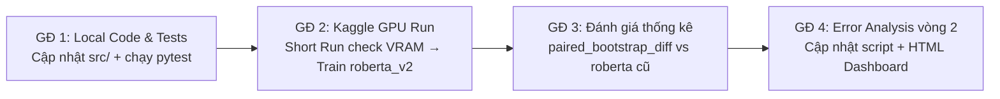

# Phân tích Nguyên nhân Dữ liệu & Quy trình Triển khai Cải tiến (RoBERTa)

> **Tài liệu liên quan:**
> - [error_analysts.md](file:///D:/DEEP%20LEARNING/topic/docs/analysts/error_analysts.md)
> - [error_analysis_summary.md](file:///D:/DEEP%20LEARNING/topic/reports/error_analysis_summary.md)
> - [error_analysis_dashboard.html](file:///D:/DEEP%20LEARNING/topic/reports/error_analysis_dashboard.html)
> - [01-yelp-data-eda-baseline.ipynb](file:///D:/DEEP%20LEARNING/topic/notebooks/01-yelp-data-eda-baseline.ipynb)
> - [02-yelp-gpu-training.ipynb](file:///D:/DEEP%20LEARNING/topic/notebooks/02-yelp-gpu-training.ipynb)

---

## 1. Bối cảnh & Hiện trạng

Mô hình tốt nhất hiện tại theo [model_summary.csv](file:///D:/DEEP%20LEARNING/topic/data/model_summary.csv) (`split_id = f0e6776f8a1a`, `42,000` Train / `9,001` Val / `8,999` Test):

| Mô hình | MAE | RMSE | RMSE raw | R² | Macro-MAE |
|---|---:|---:|---:|---:|---:|
| `mean_predictor` | 1.261615 | 1.478705 | 1.478705 | — | 1.349705 |
| `baseline` (TF-IDF + Ridge) | 0.575839 | 0.776944 | 0.800360 | 0.723932 | 0.631966 |
| `distilbert` | 0.363299 | 0.569338 | 0.570484 | 0.851756 | 0.453565 |
| `bert` | 0.341089 | 0.560791 | 0.562757 | 0.856173 | 0.440476 |
| **`roberta`** | **0.314809** | **0.524019** | **0.526444** | **0.874417** | **0.409082** |

Kết quả phân tích lỗi tự động trên **40 mẫu** (`20 worst + 20 random` phân tầng 4 mẫu/sao) trong [error_analysis_summary.md](file:///D:/DEEP%20LEARNING/topic/reports/error_analysis_summary.md):
- **Khác**: `20` mẫu (`50.0%` — `11` worst, `9` random)
- **Cảm xúc lẫn lộn**: `11` mẫu (`27.5%` — `2` worst, `9` random)
- **Bị cắt 256 token**: `8` mẫu (`20.0%` — `6` worst, `2` random)
- **Mỉa mai**: `1` mẫu (`2.5%` — `1` worst, `0` random)
- **Nhãn nhiễu**: `0` mẫu (`0.0%`)
- Toàn tập Test (`8,999` review) có **`11.55%`** (`1,039` review) vượt `n_tokens > 254`.

---

## 2. Đánh giá Dữ liệu & EDA: Những nguyên nhân chưa được làm sạch / xử lý

### 2.1. Quy trình ban đầu đã làm tốt phần kỹ thuật
Trong [src/data_setup.py](file:///D:/DEEP%20LEARNING/topic/src/data_setup.py) và [01-yelp-data-eda-baseline.ipynb](file:///D:/DEEP%20LEARNING/topic/notebooks/01-yelp-data-eda-baseline.ipynb), dữ liệu đã được kiểm soát chặt ở mức định dạng và chia tập:
- Loại bỏ dòng lỗi JSON, thiếu trường bắt buộc, `stars` không hợp lệ ngoài `{1..5}`, `text` rỗng.
- Chuẩn hoá chuỗi trong `_clean_text()`: `strip() -> lower() -> unicodedata.normalize("NFC") -> collapse whitespace`.
- Loại trùng exact text giữa `val`/`test` so với `train`.
- EDA xác nhận: 0 giá trị null, 0 trùng lặp `review_id`/`text`, phân phối sao giữa Train/Val/Test cân bằng (`max_diff <= 0.01%`).

### 2.2. 4 nguyên nhân từ dữ liệu chưa được xử lý dẫn đến sai số lớn

| # | Nguyên nhân dữ liệu | Bằng chứng thực tế trong dữ liệu | Tác động lên mô hình |
|:---:|---|---|---|
| **1** | **Ép viết thường (`.lower()`) ở `_clean_text()`** | [src/data_setup.py](file:///D:/DEEP%20LEARNING/topic/src/data_setup.py#L33) ép toàn bộ văn bản về lowercase trước khi lưu parquet, trong khi [model_builder.py](file:///D:/DEEP%20LEARNING/topic/src/model_builder.py#L12) dùng `roberta-base` (mô hình **cased**, phân biệt hoa/thường). | RoBERTa mất tín hiệu nhấn mạnh cảm xúc từ chữ IN HOA (`HORRIBLE`, `NEVER AGAIN`, `BEST`) và danh từ riêng. |
| **2** | **Review nhiều giai đoạn (`Update:` / `Revised review:`) kết hợp cắt đuôi 256 token** | Trong [error_sample_with_text.csv](file:///D:/DEEP%20LEARNING/topic/reports/error_sample_with_text.csv): • `Drdrx5eWHCR-ZLP4Pl8iew` (`462` token, thật **5**, dự đoán **1.000**): đầu bài chê dài dòng, cuối bài có `update 11/18/2017...` hài lòng. • `k0iGnHmIPWuZNrUWuJEOAQ` (`575` token, thật **5**, dự đoán **1.050**): chê suốt phần đầu, cuối bài có `update: after my last review...`. • `PXnWZ95OJIVXUmOxVWa-nA` (`262` token, thật **5**, dự đoán **1.408**): cuối bài có `1/17/19 i want to give an update...`. • `GPcH6XYNkGOntvVHd6gD8g` (`516` token, thật **2**, dự đoán **4.996**): đầu bài `original review was 5 stars:...`, cuối bài `revised review:...` hạ xuống 2 sao. | `ReviewDataset.__getitem__` dùng `truncation=True` cắt bỏ hoàn toàn phần đuôi. Mô hình chỉ đọc phần đánh giá cũ và dự đoán ngược hoàn toàn với nhãn cuối. |
| **3** | **Sót nhiễu scraping, lỗi mã hoá (mojibake), lặp đoạn & URL/hashtag** | • Mẫu `4rgtY9o7cZ7aR0MfU5RIVQ` (`255` token) dính lỗi ký tự `â¿by-the-sliceâ¿` và **lặp nguyên đoạn mở đầu** sau `... (more)`, đẩy độ dài vượt 254 token. • Quét trên `8,999` mẫu tập Test ([test_predictions_with_text.csv](file:///D:/DEEP%20LEARNING/topic/data/test_predictions_with_text.csv)): còn `11` review chứa URL (`http://...`/`www.`), `50` review chứa `#hashtag`, `1` mẫu mojibake, `1` mẫu `... (more)`, `3` review `< 5` từ. | Tốn ngân sách token cho chuỗi vô nghĩa (URL, đoạn lặp) và làm tokenizer phân mảnh từ lỗi mã hoá. |
| **4** | **Nhiễu nhãn / Review lạc đề / Slang (Label noise & Off-topic)** | • `0T7-xv4N7pgSE7PazLH2bQ` (`34` token, thật **5**, dự đoán **1.020**): ngôn từ chửi tục + `#deeznutz #faded #freeboosie`. • `L5GP5dy2OqNSP8qOw48hRQ` (`26` token, thật **4**, dự đoán **1.147**): chỉ báo sai địa chỉ. • `uFtdhJZgxNJ2aW7sShagkg` (`59` token, thật **4**, dự đoán **1.128**): kể chuyện đi cấp cứu. • `sDWA9clWUIDCPOTURqxm9w` (`20` token, thật **5**, dự đoán **1.846**): 1 câu ngắn mơ hồ. | Bản chất dữ liệu Yelp thật; không nên xoá khỏi Test để tránh đánh giá ảo, nhưng cần hiểu đây là trần nhiễu tự nhiên (irreducible error). |

---

## 3. Rà soát Ràng buộc Kỹ thuật trong Codebase trước khi Triển khai

Nếu áp dụng ngay config gợi ý trong [error_analysts.md](file:///D:/DEEP%20LEARNING/topic/docs/analysts/error_analysts.md#L221-L235), pipeline sẽ gặp **3 vướng mắc kỹ thuật** cần xử lý trước:

1. **Schema validation ở `src/train.py`**:
   `load_config()` ([train.py](file:///D:/DEEP%20LEARNING/topic/src/train.py#L65-L67)) kiểm tra `unknown = set(cfg) - set(DEFAULT_CONFIG)` và từ chối mọi khóa lạ bằng `ValueError`. Các khóa như `gradient_accumulation_steps`, `gradient_checkpointing`, `output_dir` chưa nằm trong `DEFAULT_CONFIG`, và `train_one_epoch()` ([engine.py](file:///D:/DEEP%20LEARNING/topic/src/engine.py#L84-L157)) chưa hỗ trợ cộng dồn gradient.
2. **Bảo toàn `split_id = f0e6776f8a1a` cho các vòng đầu**:
   Mọi cải tiến ở vòng đầu phải chạy trên **cùng 3 file parquet** (`train/val/test`) để so sánh công bằng với `RoBERTa` gốc (`RMSE = 0.524019`). Nếu thay đổi `prepare_splits()` (như tăng `n_samples` hoặc bỏ `.lower()`), `split_id` sẽ đổi và phải train lại Baseline/BERT.
3. **Đồng bộ `max_length` ở khâu suy luận (Evaluation/Predict)**:
   Cả `create_dataloaders()` ([data_setup.py](file:///D:/DEEP%20LEARNING/topic/src/data_setup.py#L313)) và `predict()` ([predict.py](file:///D:/DEEP%20LEARNING/topic/src/predict.py#L71)) đều mặc định `max_length=256`. Khi đánh giá mô hình train ở `512` token, phải truyền tường minh `max_length=512` (hoặc đọc từ `run_config["max_length"]`).

---

## 4. Quy trình Triển khai Chuẩn (4 Giai đoạn)

### Giai đoạn 1 — Chuẩn bị code & kiểm thử ở Local
1. Sửa nhẹ tiền xử lý runtime (hoặc trong `ReviewDataset`): loại URL, xoá lặp đoạn `... (more)`, chuẩn hoá encoding; thêm tùy chọn cắt **Head + Tail** (giữ phần đầu + phần cuối thay vì cắt bỏ đuôi).
2. Mở rộng `DEFAULT_CONFIG` trong [src/train.py](file:///D:/DEEP%20LEARNING/topic/src/train.py) (thêm `gradient_accumulation_steps`, `truncation_strategy`, v.v.) và hỗ trợ cộng dồn gradient trong [src/engine.py](file:///D:/DEEP%20LEARNING/topic/src/engine.py).
3. Chạy `pytest` toàn bộ suite hiện tại (`tests/`) để bảo đảm tương thích ngược.

### Giai đoạn 2 — Huấn luyện kiểm chứng trên Kaggle GPU
1. Chạy **Short Run (1 epoch)** trên `train.parquet` với `max_length: 512` để đo thời gian/epoch và mức chiếm VRAM thực tế trên T4/P100.
2. Tạo cấu hình `configs/train_roberta_v2.yaml` với `run_name: roberta_v2` (giữ nguyên checkpoint & log của `roberta` cũ để đối chiếu).
3. Chạy full training (`fit()` tự động lưu `best_model.pt` theo `val_rmse` thấp nhất qua các epoch).

### Giai đoạn 3 — Đánh giá định lượng trên cùng Test Set (`8,999` mẫu)
1. Xuất dự đoán Test với `max_length` khớp config train.
2. Dùng `paired_bootstrap_diff()` trong [src/metrics.py](file:///D:/DEEP%20LEARNING/topic/src/metrics.py#L192-L236) để kiểm định hiệu chênh lệch `RMSE` và `MAE` giữa `roberta` cũ và `roberta_v2` (xem khoảng tin cậy 95% có nằm hoàn toàn dưới 0 hay không).

### Giai đoạn 4 — Error Analysis vòng 2
1. Cập nhật [scripts/error_analysis.py](file:///D:/DEEP%20LEARNING/topic/scripts/error_analysis.py) (nới ngưỡng token theo `max_length` mới, bổ sung nhận diện `update:`/`revised review:`, mở rộng từ điển khen/chê).
2. Chạy lại phân tích lỗi và cập nhật HTML dashboard để kiểm tra tỷ lệ từng nhóm lỗi sau cải tiến.

---

## 5. Bảng Sắp xếp Thứ tự Ưu tiên (P0 → P5)

| Thứ tự | Hạng mục cải tiến | Nhóm lỗi mục tiêu | File tác động chính | Effort | Kỳ vọng Impact | Ghi chú triển khai |
|:---:|---|---|---|---:|:---:|---|
| **P0** | **Tăng `max_length` (`256 → 512`) hoặc cắt Head+Tail + làm sạch nhẹ (URL, `... (more)`, mojibake)** | **Bị cắt 256 token (`20%`, MAE ~2.72)** & review có **`update:` / `revised review:`** | `src/data_setup.py`, `src/train.py`, `src/engine.py`, `src/predict.py`, YAML mới | Thấp–TB | **Cao** | Giải quyết trực tiếp các ca top worst error (`4.00`, `3.95`, `3.59`, `3.00`), giữ nguyên `split_id`. |
| **P1** | **Tăng `epochs` (`3 → 4 hoặc 5`) + giữ effective `batch_size = 16` (`8 × accum 2`)** | **Nhóm Khác** & tối ưu hội tụ toàn cục | `src/train.py`, `src/engine.py`, YAML mới | Thấp | **Trung bình** | Kiểm tra `history.csv` của `roberta` cũ trước; `fit()` tự chọn best epoch theo `val_rmse`. |
| **P2** | **Nâng cấp `scripts/error_analysis.py`** (nhận diện `update:`, mở rộng từ điển `POS`/`NEG`/`CONTRAST`, ngưỡng token động) | Giảm phân loại sai vào **Nhóm Khác (`50%`)** | `scripts/error_analysis.py`, `tests/test_error_analysis.py` | Thấp | **Cao (về độ chính xác chẩn đoán)** | Không cần GPU; giúp đánh giá đúng nguyên nhân lỗi sau khi chạy P0+P1. |
| **P3** | **Chuyển Head sang phân phối 5 mức sao (Ordinal / Expected-value: `Linear(H, 5)` + kỳ vọng Softmax)** | **Cảm xúc lẫn lộn (`27.5%`)** | `src/model_builder.py`, `src/engine.py`, `src/predict.py` | Cao | **Cao** | Tránh việc mô hình bị kéo về 1★ hoặc 5★ khi gặp review pha trộn khen–chê. |
| **P4** | **Tạo `split_id` mới: giữ chữ hoa/thường cho RoBERTa (bỏ `.lower()`) + tăng `n_samples` (`60K → 100K+`)** | Review nhấn mạnh IN HOA & biểu đạt ít gặp | `src/data_setup.py`, Notebook 1 & 2 | TB–Cao | **Trung bình–Cao** | Đổi `split_id`, bắt buộc chạy lại Baseline/BERT trên tập mới để so sánh công bằng. |
| **P5** | **Backbone lớn hơn (`roberta-large`) hoặc Multi-task learning** | **Mỉa mai (`2.5%`)** & sắc thái phức tạp | `src/model_builder.py`, `src/engine.py` | Rất cao | **Thấp–TB** | Tốn gấp ~3× VRAM/thời gian trên Kaggle T4; chỉ cân nhắc sau khi xong P0–P4. |

---

## 6. Bước Hành động Đề xuất Tiếp theo

Thực hiện cuốn chiếu **P0 + P1 + P2** ở local trước khi train lại trên Kaggle:
1. Cập nhật `src/train.py` & `src/engine.py` hỗ trợ `gradient_accumulation_steps` (giữ `batch_size=8, accum=2` cho `max_length=512`).
2. Thêm làm sạch nhẹ + tùy chọn `truncation_strategy: "head_tail"` trong `src/data_setup.py` và đồng bộ `max_length` khi predict.
3. Tạo `configs/train_roberta_v2.yaml` hợp lệ hoàn toàn với `load_config()`.
4. Chạy `pytest` kiểm tra toàn bộ test suite trước khi đẩy lên Kaggle GPU.

